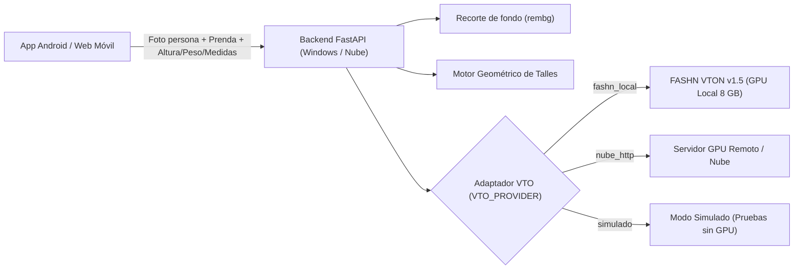

# Arquitectura del Sistema — Proyecto Ali

## 1. Visión general

El sistema separa completamente la **interfaz móvil (Android / Web móvil)** del **motor de Inteligencia Artificial** mediante una API REST en **FastAPI**. Esto permite cambiar el modelo de generación de imagen (local en RTX 3080, CatVTON, FASHN VTON v1.5 o un servidor en la nube) modificando únicamente la variable de entorno `VTO_PROVIDER`.

## 2. Flujo de datos (basado en la investigación de viabilidad)

1. **Datos de la persona:**
   * Fotografía frontal (con guía de postura).
   * Altura (`cm`), peso (`kg`) y género/complexión.
   * Medidas detalladas opcionales: pecho/busto, cintura, cadera, hombros, largo de torso/entrepierna.
2. **Datos de la prenda:**
   * Fotografía de la prenda (con recorte automático de fondo).
   * Categoría (`superior`, `inferior`, `cuerpo_entero`).
   * Composición/elasticidad (`rigido`, `medio`, `elastico`) y tabla de talles.
3. **Procesamiento híbrido:**
   * **Motor de talles:** Estima medidas faltantes a partir de altura/peso si no se ingresan, y las cruza con la tabla de talles de la prenda para recomendar el talle exacto (`XS` a `XXL`) y nivel de ajuste (`holgado`, `justo`, `ajustado`).
   * **Adaptador VTO:** Genera la imagen compuesta respetando la interfaz `MotorTryOn`.
4. **Privacidad:**
   * Consentimiento explícito requerido antes de procesar imágenes biométricas.
   * Las imágenes temporales de sesión pueden eliminarse automáticamente al finalizar la prueba.

## 3. Cómo agregar o cambiar un modelo de IA

Todos los motores implementan la clase abstracta `MotorTryOn` en `backend/app/adapters/base.py`. Para migrar a la nube en el futuro, basta con configurar `VTO_PROVIDER=nube_http` y `VTO_CLOUD_URL` en `.env`.
